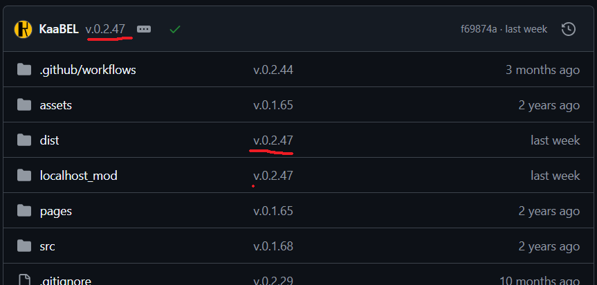

<!-- v.0.2.48 -->
## Shittalk

| The image was too huge under this paragraph xD | Smol image |
| :--: | :--: |
| Up until now you were supposed to ask me, but since I plan to stop active development I'll at least throw our a documentation on how is the codebase built and give some examples on how to extract games data. If you've already looked into the `src/` directory you haven't scratched even the surface of DBVE (the shortest and most common abbreviation for Droneboi +Modular Spaceships editor), the actual source is equal to production page source and is apparent if you notice the up to date version for `dist/` directory: |  *pic. 1, Dist directory* |

## Codebase structure
As mentioned above the editor's source&production code is within `dist/` directory used fot root of the .D1R.DBV site's sources. `src/` then contains an alternative and experimental form for DBVE source code, which is what it could like if you wanted it as TS files, but stuck at only version 0.1.64T14. ...

All of the essential assets for rendering ships are within .JS files and the bare minimum is `editor.html`, `code/_k_api.js`, `code/code.js`, `code/editor.js`, can be run directly through file URL like `file:///C:Users/Name/Downloads/editor.html` (if you placed contents of `dist/` into Downloads dir). Even though the codebase is made of inline scripts, `code.js` being its core can be ran separately or with Node.js, but otherwise the 'proceeding' scrpits depend on eachother:  
  
*pic. 2, main codebase structure*  

### editor.html:  
In offline works alone without javascript files, showing the Welcome message, optionally display "enable javascript" message when javascript is disabled. Contains also javascript for default error alert with `window.onerror`, **replaces `WebSocket` with fake function** to break Live Servers auto reload, changes title to short form for tab and other little dynamic parts to the to document also based on URL parameters.
### _k_api.js:  
Serves as API for unifying events from various js input API to handle movement, pinch in/out and delegate uniform data for touches, mouse and in future other pointers. File also introduces some constatns such as F for empty functions and UDF for minified undefined, util functions and legacy global variables for early version of the events API: `touchdevice`, `press`, `move`, `contextmenu`, `over` and `init`, which are still used and mostly functional with existing `Command`s. Then initializes logs related to "Eval addon" command from alphalunar.js.
### code.js:  
This is file for all editing and ships/blocks data oriented code. WIP...

# Basic setup
On my PC localhost is ran for http://localhost:5500/.d1r.dbv/dist/editor.html?debug&http:=.localhost:8158&debug_feature=none&no=info
